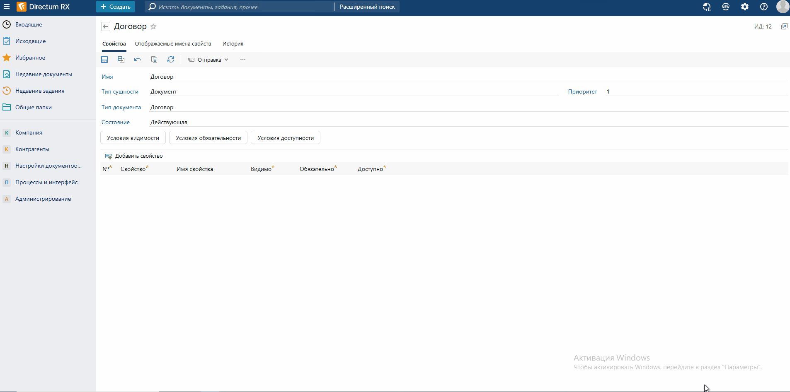

# Решение «Управление состоянием свойств сущностей»

## Назначение
Решение предназначено для управления состоянием свойств сущностей Directum RX (видимость, доступность, обязательность, отображаемое имя) на основе настраиваемых администратором логических выражений — без написания кода для каждого свойства.

## Описание
Шаблон разработки для динамического управления формой карточки в Directum RX. Позволяет настраивать поведение свойств через справочник-конфигуратор с визуальным редактором условий, поддерживающим вложенные свойства, группы И/ИЛИ и сравнение двух полей.

В типовых проектах внедрения Directum RX часто возникает потребность в том, чтобы поведение карточки зависело от бизнес-логики:
* Показывать поле «Сумма с НДС» только после того, как заполнено «Сумма без НДС»
* Делать поле «Контрагент» обязательным только для договоров определённого вида
* Скрывать блок «Основание» для документов, созданных на основании заявки
* Переименовывать поле «Содержание» для разных видов документов

Штатно такие сценарии решаются либо созданием представления формы сущности, либо перекрытием обработчиков карточки на C#: для каждого свойства пишется свой код, который проверяет условия и выставляет `IsVisible` / `IsEnabled` / `IsRequired`. Это приводит к следующим проблемам:

* Разрастание кода — перекрытие на каждый тип документа
* Сложность поддержки — изменение бизнес-правила требует правки кода, пересборки и перевыпуска решения
* Непрозрачность для бизнеса — настройщик не может изменить правило без разработчика

Решение выносит логику в справочник-конфигуратор: администратор настраивает правила через визуальный редактор, а платформа применяет их динамически при открытии и изменении карточки. Код при этом не пишется и не пересобирается.



## Возможности решения

Обеспечение гибкого управления состоянием свойств карточек на основе логических выражений с минимальными трудозатратами на настройку и без перекрытия коробочных сущностей.

Решение позволяет:

* Настраивать видимость, доступность, обязательность свойства и его отображаемое имя через справочник-конфигуратор
* Задавать сложные условия с логическими операторами И/ИЛИ
* Сравнивать значения свойств сущностей с фиксированным значением или результатом вычисляемого выражения
* Работать со всеми типами свойств: строками, перечислениями, ссылочными, датами, числами, булевыми значениями
* Сравнивать два свойства между собой, в том числе через вложенные цепочки (Ведущий документ → Подписант)
* Переопределять отображаемые имена свойств для отдельных видов документов
* Применять состояния динамически при изменении карточки

## Состав решения

1. **Справочник-конфигуратор** с настройками состояний свойств:
2. **Структуры данных** для работы с логическими выражениями.
3. **Кастомный диалог на TypeScript с визуальным редактором** - для редактирования логических выражений 
4. **Серверные функции вычисления условий** - Получение значений свойств через Expression Tree с кэшированием делегатов
5. **Клиентские обработчики карточки** - применение состояний IsVisible`, `IsEnabled`, `IsRequired`. Динамическое переопределение отображаемых имён в стороннем контроле

## Порядок установки

Для работы требуется установленный **Directum Development Studio версии 25.2 и выше**.

### Установка для ознакомления

1. Склонировать репозиторий PropertyStateManager в папку (например C:\WorkFolder).
2. Указать в _ConfigSettings.xml DDS:
```xml
<block name="REPOSITORIES">
  <repository folderName="Base" solutionType="Base" url="<адрес локального репозитория>" />
  <repository folderName="Work" solutionType="Work" url="<адрес локального репозитория>" />
  <repository folderName="<Папка из п.1>" solutionType="Work" url="https://git.starkovgrp.ru/zhukov/PropertyStateManager.git" />
</block>
```

### Установка для использования на проекте
Возможные варианты:

#### A. Fork репозитория
1. Сделать fork репозитория PropertyStateManager для своей учетной записи.
2. Склонировать созданный в п. 1 репозиторий в папку.
3. Указать в _ConfigSettings.xml DDS:
```xml
<block name="REPOSITORIES">
  <repository folderName="Base" solutionType="Base" url="<адрес локального репозитория>" />
  <repository folderName="Work" solutionType="Work" url="<адрес локального репозитория>" />
  <repository folderName="<Папка из п.2>" solutionType="Work" url="<Адрес репозитория gitHub учетной записи пользователя из п. 1>" />
</block>
```

#### B. Подключение на базовый слой.
Вариант не рекомендуется:

так как при выходе новой версии шаблона разработки не гарантируется обратная совместимость;
потеряется возможность изменения или доработки функционала под собственые требования;

1. Склонировать репозиторий PropertyStateManager в папку.
2. Указать в config.yml DirectumLauncher:
```xml
			-   '@folderName': 'BulkProcessing'
                '@solutionType': 'Work'
                '@url': 'https://git.starkovgrp.ru/zhukov/PropertyStateManager.git'
```

#### C. Копирование репозитория в систему контроля версий.
Рекомендуемый вариант для проектов внедрения.

1. В системе контроля версий с поддержкой git создать новый репозиторий.
2. Склонировать репозиторий BulkProcessing в папку с ключом ```--mirror```.
3. Перейти в папку из п. 2.
4. Импортировать клонированный репозиторий в систему контроля версий командой:
```
git push –mirror <Адрес репозитория из п. 1>
```

## Настройка управления состоянием свойства

Для настройки состояний свойств докуенмтов требуется:
1.	**Создать запись в справочнике-конфигураторе** с привязкой к типу документа.
2.	**Добавить в дочернюю коллекцию свойства**, состоянием которых требуется динамически управлять.
3.	**Задать логические условия** для каждого типа состояния (видимость, доступность, обязательность) через визуальный редактор.
4.	**Добавить свойства на вкладке «Отображаемые имена свойств»**, имена которых надо заменить, с привязкой к видам документов, имена которые требуется отображать

При необходимости можно расширить справочник-конфигуратор сущностями других типов: справочники, задачи.

## Варианты расширения функциональности на проектах
1.	Добавление новых типов сущностей для настройки состояния свойств.
2.	Добавление новых операторов сравнения — «начинается с», «заканчивается на», «содержит подстроку».
3.	Арифметические выражения — вычисление значения правой части (например, Сумма > Лимит * 2).
4.	Встроенные функции для условий: IsWeekend(), DaysBetween(), CurrentUser().
5.	Агрегации по коллекциям — условия вида «среди строк таблицы есть хотя бы одна с ...».
6.	Инициализация роли для настройки доступа к возможностям решения

## Архитектурно неочевидные моменты
1.	Логические условия хранятся в JSON справочника-конфигуратора 
2.	Получение значений свойств через Expression Tree — Скомпилированные делегаты кэшируются в ConcurrentDictionary.
3.	Переопределение отображаемых имён работает через прямое изменение DOM в React-компоненте.
4.	Открытие модального окна настроек реализовано через кастомный React-компонент (<Modal> из Ant Design). Состояние видимости управляется хуком useStateEditor (isModalVisible, openEditor, closeEditor).

## Ограничения
При использовании **представлений форм** необходимо учитывать следующее ограничение:
Если свойство, указанное в настройке, отсутствует на представлении формы — оно игнорируется при вычислении состояния.
Это означает, что настройки состояний применяются только к тем свойствам, которые реально присутствуют на форме. Свойства, не выведенные на форму, не участвуют в вычислении и не влияют на результат.

> [!NOTE]
> Замечания и пожелания по развитию шаблона разработки фиксируйте через [Issues](https://github.com/STARKOV-Group/BulkProcessing/issues).
> При оформлении ошибки, опишите сценарий для воспроизведения. Для пожеланий приведите обоснование для описываемых изменений - частоту использования, бизнес-ценность, риски и/или эффект от реализации.  
> Внимание! Изменения будут вноситься только в новые версии.

